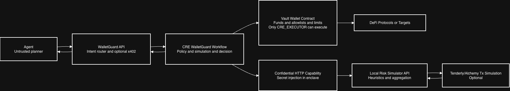
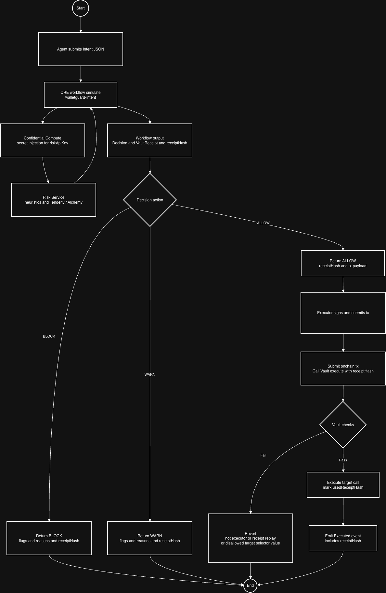
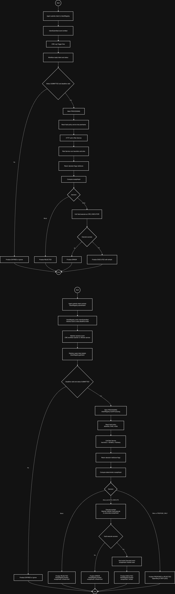

# WalletGuard (Chainlink Convergence Hackathon 2026)

Video explainer: https://youtu.be/ZxlSbMzT21Q

## Executive summary

WalletGuard is an **agent-friendly transaction firewall** built on **Chainlink CRE**.

It’s designed for a world where agents can be prompt-injected and may unknowingly propose transactions that interact with malicious contracts (phishing routers, approval drains, stealth delegatecalls, internal value leaks).

WalletGuard separates planning from execution:

- **[Agent proposes intents]** Agents propose *what they want to do*, but do not hold the treasury keys.
- **[CRE evaluates]** A CRE workflow evaluates the intent using deterministic checks + simulation signals (Alchemy + Tenderly).
- **[Receipt + decision]** The workflow produces a deterministic receipt hash and a clear decision: `allow` / `warn` / `block`.
- **[Vault gates execution]** A vault only executes transactions that match an approved receipt, and rejects replays of previously used receipt hashes.

This repo includes:

- **[CRE workflows]**
  - `walletguard-intent` (intent -> risk -> receipt)
  - `walletguard-analyze` (report-style analysis)
  - `walletguard-watcher` (Sepolia watcher: `IntentRegistry` -> risk -> `Receiver` -> optional vault execution)
- **[Risk engine service]** `apps/risk-service` (Tenderly/Alchemy simulation + heuristics)
- **[Optional API]** `apps/api` (HTTP endpoints to analyze an intent and execute via a demo executor key)
- **[Contracts]** `WalletGuardVault`, `ReportRegistry`, `IntentRegistry`, `WalletGuardWatcherReceiver` + deployable test contracts

### What it protects against

WalletGuard is built to reduce the risk of agents interacting with malicious contracts by:

- enforcing allowlisted targets/selectors at the vault layer
- flagging risky patterns like max approvals, untrusted spenders/recipients, unknown selectors, and hidden internal behaviors visible only in simulation traces
- making execution conditional on receipt-based approval

### Core outputs

Each run returns:

- **[Decision]** `allow` / `warn` / `block`
- **[Flags + reasons]** human/agent-readable explanation of what’s risky and why
- **[Receipt hash]** deterministic identifier that can be enforced onchain to gate execution and prevent replay

### Agent wallet model (important)

An agent still needs a wallet in this flow — for example to:

- pay gas / fees
- pay per-call for services in the future (x402)
- sign non-treasury actions

But the agent wallet should only hold small operational balances, not large funds. Large funds live in the Vault, which enforces policy and execution constraints.

### Roadmap (what comes next)

#### x402: pay-per-check and agent-to-service payments

We plan to add x402 as a clean paywall and accounting mechanism:

- agents can pay for WalletGuard analysis/execution requests per call
- or pay for premium risk checks / simulators
- with optional vault reimbursement based on verifiable receipts

#### More DeFi coverage via typed intent formats

Today’s MVP supports a single-call “transaction intent” (`to`/`value`/`data`). Next, we expand with typed intents where the workflow builds calldata safely from parameters:

- `ApproveIntent` (exact/capped approvals, no infinite approvals by default)
- `SwapIntent` (allowlisted routers, slippage caps, deadlines, expected deltas)
- `DepositIntent` / `WithdrawIntent` (lending pools, vaults)
- `ClaimIntent` (rewards harvesting)
- later: multi-step plans (`ApproveIfNeeded` → `Swap` → `Deposit`) and cross-chain/CCIP-style intents

Each new intent type ships with matching WalletGuard checks:

- semantic validation
- simulation assertions (deltas)
- counterparty risk checks

### How we compare to agentic wallet products (Coinbase Agentic Wallet, etc.)

Agentic wallet products (like Coinbase Agentic Wallet) provide a convenient wallet and guardrails for agents to spend and operate (e.g., small payments, trading, gasless UX). WalletGuard is complementary:

- **[Agentic Wallet]** agent spending wallet (operational funds, convenience, payments)
- **[WalletGuard + Vault]** secure execution and safety gate for vault funds (treasury-grade policy + simulation + onchain enforcement)

In other words: agent wallets are great for “petty cash,” while WalletGuard is meant to protect large-value vault funds by making execution conditional on verifiable safety checks.

## How it works (high level)

- **[Agent proposes an intent]** (JSON) describing the transaction it wants the vault to execute.
- **[Optional onchain intent lane]** Onchain, intents can be submitted to `IntentRegistry` (emits `IntentSubmitted`).
- **[CRE workflow runs]** and retrieves a secret `riskApiKey` via CRE secret injection.
- **[Workflow calls risk-service]** `/risk/tx` with the transaction + optional expectations.
- **[Workflow decides]** `allow` / `warn` / `block` and builds a deterministic `VaultReceipt`.
- **[Execution is gated by receipt hash]**
  - **[Direct execute lane]** a demo executor submits `WalletGuardVault.execute(..., receiptHash)`.
  - **[Watcher lane]** `walletguard-watcher` writes a report to `WalletGuardWatcherReceiver`, which finalizes the onchain intent and can optionally call the Vault.

## Quickstart (local demo)

### Prereqs

- **[Node]** `>= 18`
- **[pnpm]** `>= 8`
- **[Chainlink CRE CLI]** `cre` available on PATH
- **[bun]** for `./cre-compile-workflow` (repo shim)

### Install

```bash
pnpm install
```

### Run risk-service (local)

```bash
RISK_API_KEY_ALL=demo-key-123 \
PORT=8812 \
ALLOWED_ADDRESSES=0x779877a7b0d9e8603169ddbd7836e478b4624789 \
pnpm --filter @walletguard/risk-service dev
```

Optional (better simulation signals):

- `TENDERLY_ACCESS_TOKEN=...`
- `TENDERLY_ACCOUNT_SLUG=...` (default `bnstrhbn`)
- `TENDERLY_PROJECT_SLUG=...` (default `project`)
- `ALCHEMY_RPC_URL=...` (fallback)
- `DEBUG_TENDERLY=1`

### Simulate the CRE workflow (intent -> receipt)

```bash
cre -T staging-settings workflow simulate ./cre-workflows/walletguard-intent \
  --non-interactive \
  --trigger-index 0 \
  --http-payload @./cre-workflows/walletguard-intent/fixtures/intent-02-approve-max.json
```

Notes:

- The workflow uses `cre-workflows/walletguard-intent/config.staging.json` with `riskApiUrl=http://localhost:8812/risk/tx`.
- The workflow secret mapping is in `secrets.yaml` (`riskApiKey` comes from env `RISK_API_KEY_ALL`).

## Configuration (what to set, and where)

Copy `.env.example` to `.env` (not committed) and set what you need.

CRE settings:

- **[RPC endpoints]** `project.yaml` defines the `-T staging-settings` / `-T production-settings` RPC URLs used by `cre workflow simulate`.
- **[Secrets injection]** `secrets.yaml` maps secret id `riskApiKey` to env `RISK_API_KEY_ALL`.

Risk service (`apps/risk-service`) env:

- **[Auth]** `RISK_API_KEY_ALL` (if set, `/risk/tx` requires `Authorization: Bearer <key>`)
- **[Allowlist]** `ALLOWED_ADDRESSES` (comma-separated addresses considered “safe”; used by heuristic + sim flags)
- **[Networking]** `PORT` (default `8811`; staging workflow points to `8812`)
- **[Simulation]**
  - `TENDERLY_ACCESS_TOKEN`, `TENDERLY_ACCOUNT_SLUG`, `TENDERLY_PROJECT_SLUG` (preferred simulator)
  - `TENDERLY_RPC_URL` (optional RPC simulate endpoint)
  - `ALCHEMY_RPC_URL` or `RPC_URL` (Alchemy simulate + Tenderly REST block lookup fallback)
  - `DEBUG_TENDERLY=1` (extra logs)

Optional API (`apps/api`) env:

- **[Risk service]** `RISK_API_URL` (e.g. `http://localhost:8812/risk/tx`)
- **[Risk auth]** `RISK_API_KEY` or `RISK_API_KEY_ALL`
- **[Executor]** `CRE_EXECUTOR_PRIVATE_KEY` + `RPC_URL` (used to submit `WalletGuardVault.execute()`)

## Agent handoff: how to submit intents

An “intent” is a JSON payload that matches `VaultIntentSchema` in `@walletguard/common`.

### Intent schema (what an agent must send)

Required:

- **[chainId]** EVM chain id (e.g. Sepolia `11155111`)
- **[vault]** address of the `WalletGuardVault`
- **[to]** target contract address
- **[data]** calldata hex (`0x` or `0x` + selector + ABI encoded args)
- **[requestId]** unique id for dedup/debugging
- **[mode]** `AUTO_EXECUTE` or `PROPOSE_ONLY`

Optional:

- **[value]** ETH value in wei as a decimal string
- **[expectedTokenBalanceDeltas]** “I expect balances to change like this” guardrail
- **[metadata.origin]** string for observability

`expectedTokenBalanceDeltas[]` fields:

- **[token]** ERC20 token contract address
- **[holder]** address whose balance delta you care about (often the vault)
- **[delta]** signed decimal string (e.g. `"-1000000000000000000"`)
- **[tolerance]** optional unsigned decimal string for fuzz/rounding (default `0`)

### How an agent produces calldata

- **[Recommended]** Use ABI + `encodeFunctionData` (e.g. via `viem`) to produce `data`.
- **[Fixtures]** See `cre-workflows/walletguard-intent/fixtures/*.json` for known-good encoded examples.

### CLI: simulate an intent (agent-safe, no onchain execution)

```bash
cre -T staging-settings workflow simulate ./cre-workflows/walletguard-intent \
  --non-interactive \
  --trigger-index 0 \
  --http-payload @./path/to/intent.json
```

### HTTP API (optional): analyze + execute

The repo includes an optional Express API that wraps analysis and execution for demos.

Start:

```bash
pnpm --filter @walletguard/api dev
```

Analyze (returns a `VaultReceipt`):

```bash
curl -sS http://localhost:3000/intent/analyze \
  -H 'Content-Type: application/json' \
  -d @./path/to/intent.json
```

Execute (submits onchain tx via `CRE_EXECUTOR_PRIVATE_KEY`, will refuse if `decision.action=block`):

```bash
curl -sS http://localhost:3000/intent/execute \
  -H 'Content-Type: application/json' \
  -d @./path/to/receipt.json
```

## Risk checks (what WalletGuard evaluates)

There are two layers:

### 1) Heuristic checks (fast, calldata-only)

Implemented in `apps/risk-service/src/index.ts` (`computeRisk()`):

- **[allowlist target enforcement]** `TARGET_NOT_ALLOWLISTED`
- **[recipient allowlist]** `RECIPIENT_NOT_ALLOWLISTED` for `transfer`, `transferFrom`, and empty-calldata value sends
- **[spender allowlist]** `SPENDER_NOT_ALLOWLISTED` for `approve` and `setApprovalForAll`
- **[approval sizing]** `MAX_APPROVAL` for `approve(..., 2^256-1)`
- **[selector decoding]**
  - `ERC20_APPROVE`, `ERC20_TRANSFER`, `ERC20_TRANSFER_FROM`, `ERC721_APPROVAL_FOR_ALL`
  - `UNKNOWN_SELECTOR` (treated as block-level)
- **[ETH value sanity]** `INVALID_VALUE`, `HIGH_VALUE`

### 2) Simulation checks (Tenderly/Alchemy)

Implemented in `riskFromSimSummary()`:

- **[revert & errors]** `SIM_REVERT`, `SIM_ERROR`
- **[gas]** `SIM_HIGH_GAS`
- **[event-driven detection]**
  - `SIM_APPROVAL` + `SPENDER_NOT_ALLOWLISTED` even when top-level call is not `approve`
  - `SIM_TOKEN_OUTFLOW` + `RECIPIENT_NOT_ALLOWLISTED` based on ERC20 `Transfer` logs
- **[agent expectation guardrail]**
  - `EXPECTED_TOKEN_DELTA_MISMATCH`
  - `EXPECTED_TOKEN_DELTA_UNAVAILABLE`
- **[trace-based “hidden behavior” detection]** (Tenderly `simulation_type=full`)
  - `SIM_DELEGATECALL_PATH`
  - `SIM_REENTRANCY`
  - `SIM_INTERNAL_TARGET_NOT_ALLOWLISTED`
  - `SIM_INTERNAL_VALUE_TRANSFER`
  - `SIM_INTERNAL_VALUE_TRANSFER_NOT_ALLOWLISTED`

### Decisions

Both the workflow and API use the same thresholding:

- `riskScore >= 80` => `block`
- `riskScore >= 40` => `warn`
- else => `allow`

## Test states & fixtures

### CRE workflow: `walletguard-intent`

Fixtures in `cre-workflows/walletguard-intent/fixtures/`:

- **[intent-01]** ERC20 `transfer` 0 amount (baseline)
- **[intent-02-approve-max]** unlimited approval (should flag `MAX_APPROVAL`)
- **[intent-03-transfer-disallowed]** transfer to non-allowlisted recipient
- **[intent-04-unknown-selector]** unknown selector (treated as block-level)
- **[intent-05-eth-high-value]** high-value ETH send
- **[intent-06-approve-nonmax]** non-max approval (still approval risk)
- **[intent-07-transferfrom-disallowed]** `transferFrom` to non-allowlisted recipient
- **[intent-08-expected-delta-mismatch]** expected balance delta mismatch
- **[intent-09-trace-internal-value-transfer-template]** trace-based internal ETH leak via `EvilForwarder.drip()`

`intent-09` setup:

- Deploy `EvilForwarder` via `pnpm --filter @walletguard/contracts deploy:test-contracts`.
- Add the deployed forwarder address to `ALLOWED_ADDRESSES`.
- Do **not** allowlist the recipient `0x90077d0d828f177e0fe7405ea3f3b38132108648`.

### CRE workflow: `walletguard-analyze`

This workflow produces a report-like output using deterministic rules in `packages/walletguard-core`.

Regression script:

```bash
pnpm fixtures:check-baseline
pnpm fixtures:update-baseline
pnpm fixtures:rpc-smoke
```

Baselines live in `scripts/fixtures-baseline.staging-settings.json`.

## Contracts

### WalletGuardVault

`contracts/src/WalletGuardVault.sol`:

- Only a configured `creExecutor` can call `execute()`.
- Vault enforces:
  - allowlisted `targetAllowed[to]`
  - allowlisted `selectorAllowed[to][selector]`
  - per-tx value limit `maxValuePerTx`
  - receipt replay protection `usedReceiptHash[receiptHash]`

### ReportRegistry

`contracts/src/ReportRegistry.sol`: minimal onchain anchor for report hashes.

### IntentRegistry

`contracts/src/IntentRegistry.sol`: onchain intent queue + status machine.

- `submitIntent(...)` stores an intent and emits `IntentSubmitted(intentId, ...)`.
- `markProcessing(intentId)` and `finalize(intentId, ...)` are executor-gated and are used by the watcher lane.

### WalletGuardWatcherReceiver

`contracts/src/WalletGuardWatcherReceiver.sol`: report receiver that bridges CRE -> EVM.

- Only a configured forwarder can call `onReport(...)`.
- Decodes `(registry, intentId, action, receiptHash)`.
- Reads the onchain intent, finalizes it, and (for `AUTO_EXECUTE` + `allow`) can call `WalletGuardVault.execute(...)`.

### Deployed (Sepolia)

- `WalletGuardVault`: `0x6a9e197c0e63527c8fd2217d2f6479713671cee4`
- `ReportRegistry`: `0x4fe5f64c27caeee7591b28c83af8bdfbadc290fc`

## Build notes (CRE + Javy)

The repo includes `./cre-compile-workflow`, a shim used to compile workflow JS -> WASM via the Chainlink Javy plugin.

- On macOS arm64, this shim runs `javy init-plugin` once and caches the initialized plugin to avoid a known panic.
- Root scripts:
  - `pnpm cre-compile-workflow`
  - `cre workflow simulate ...`

## Repo docs

- `PROJECT_PLAN.md`: background + next steps

## Diagrams

### Confidential Compute (current demo lane)
Block Diagram:


Flow Diagram:


Sequence Diagram:


### Watcher + Registry lane (future)
Flow Diagram:

